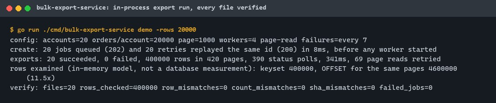
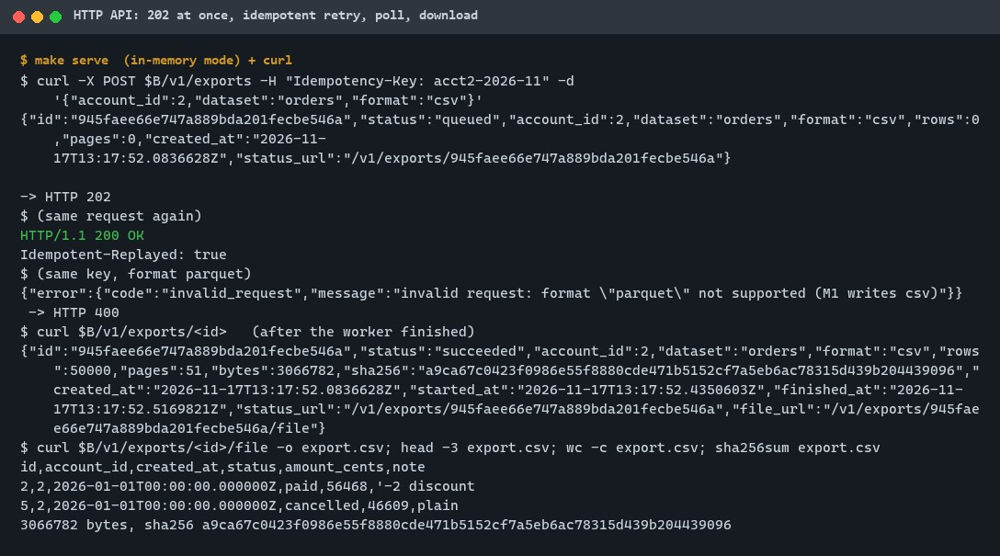
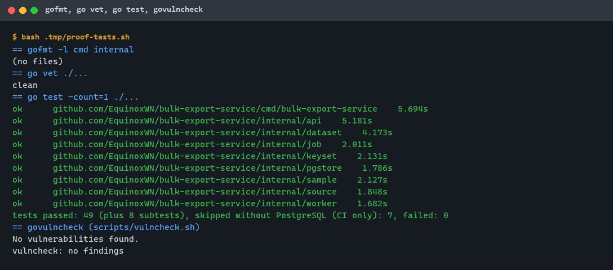
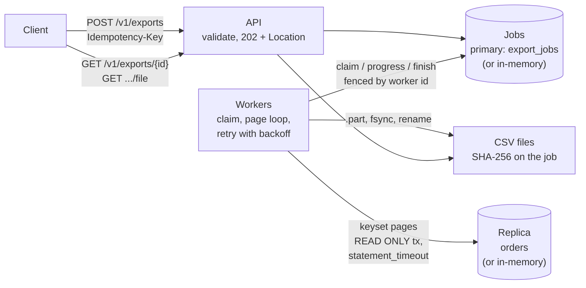
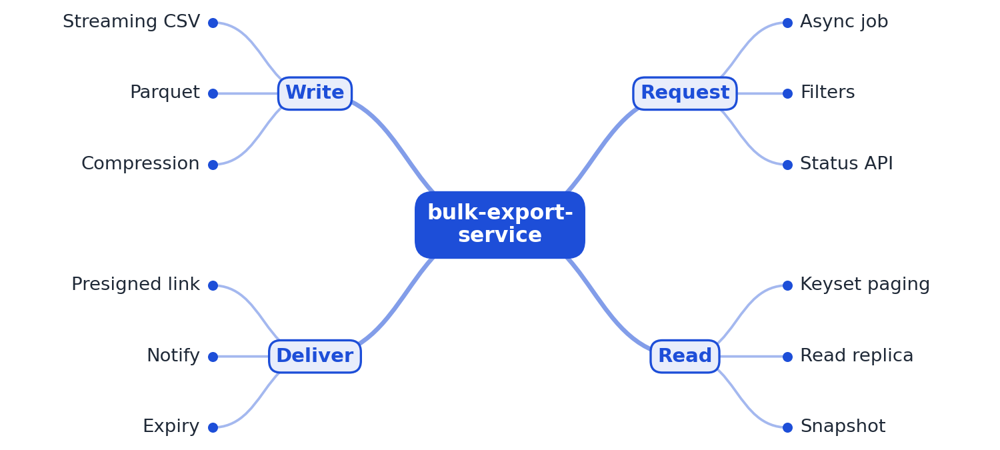

# bulk-export-service

[](https://github.com/EquinoxWN/bulk-export-service/actions/workflows/ci.yml)


> 'Export to CSV' times out on large accounts and hammers the database: asynchronous exports that stream millions of rows safely.

Part of my **Backend and API** list · Go · core project

M1 is built: an HTTP API that queues an export job and answers 202 at once (idempotent per
account and `Idempotency-Key`), a status endpoint to poll, and workers that read the account's rows
with keyset pagination through a separate read-only replica connection and write a CSV file. Jobs
live on the primary. Consistent snapshots, compressed CSV or Parquet in object storage (M2), resume
after a crash and the 50M-row benchmark (M3) are not built yet.

## Proof it works

An in-process run: 20 accounts x 20,000 orders, 4 workers, every 7th page read failing once on
purpose. All 40 create calls (20 new, 20 retries) return before any worker starts; every downloaded
file is compared row by row with the source:



The HTTP API (in-memory mode) with curl: 202 `queued`, 200 `Idempotent-Replayed: true` for the
retry, 400 for an unsupported format, then `succeeded` with 50,000 rows in 51 pages and a file whose
`sha256sum` matches the stored hash:



gofmt and go vet are clean, 49 tests pass locally (plus 8 subtests), the 7 PostgreSQL tests skip
here and run in CI, and govulncheck finds nothing:



## Architecture

**What M1 runs today:**



**Full roadmap (M1 to M3):**



## How it works

_Steps 1 and 2 are built and tested (M1); the rest is on the [roadmap](#roadmap)._

1. An export request creates a job and returns immediately; clients poll a status endpoint.
2. Workers read with keyset pagination (not OFFSET) from a read replica, protecting the primary.
3. A consistent snapshot ensures one export never mixes data from before and after concurrent changes.
4. Rows stream straight into compressed CSV or Parquet in object storage with constant memory.
5. Jobs checkpoint progress, so a worker crash resumes instead of restarting.
6. A 50M-row benchmark compares OFFSET pagination with keyset pagination.

In M1 terms:

- **Create:** `POST /v1/exports` with `{"account_id", "dataset", "format"}` and an `Idempotency-Key`
  (1-128 characters `A-Z a-z 0-9 . _ : -`). The job is stored as `queued` and the answer is 202 with
  `Location`. The same key and body again returns the same job (200, `Idempotent-Replayed: true`);
  the same key with another body is 422. Strict JSON, 4 KiB limit; `format` is `csv` in M1.
- **Poll:** `GET /v1/exports/{id}` shows `status` (`queued`, `running`, `succeeded`, `failed`), rows
  and pages so far, and when done the byte count, SHA-256 and `file_url`.
- **Keyset reads (ADR 0002):** the `orders` dataset is read per account in `(created_at, id)` order:
  `WHERE account_id = $1 AND (created_at, id) > ($2, $3) ORDER BY created_at, id LIMIT $4`, an index
  range scan on `(account_id, created_at, id)`. The last row's key is the cursor, saved with the job
  after every page. Every three sample orders share a `created_at`, so the id tiebreaker is tested.
- **Replica routing (ADR 0003):** jobs use `BULK_EXPORT_PRIMARY_DSN`; rows are read only through
  `BULK_EXPORT_REPLICA_DSN`, a separate small pool whose sessions default to read-only, one `READ
  ONLY` transaction with `statement_timeout` per page. The service refuses the same DSN for both
  (unless `-allow-shared-db`) and, with `-require-standby`, a replica that is not in recovery.
  `-page-pause` caps the load per worker.
- **Failures:** each page read has a timeout and at most `-retries` extra attempts with capped,
  jittered backoff; a failed job keeps its reason and leaves no partial file.
- **Files:** CSV with a header, written to `<out>/<id>.csv.part`, fsynced and renamed. Text cells
  starting with `= + - @`, tab or CR get a leading `'` so spreadsheets do not run them.

## Who it helps

- **Who:** Backend engineers who own a "download all my data" or "export to CSV" feature (finance
  exports, data-access requests, account migrations), and anyone preparing the pagination-at-scale
  interview question.
- **The problem:** A synchronous export with `OFFSET` pages times out on big accounts, reads more rows
  the further it gets, repeats or skips rows when data changes, and runs on the primary. Here the
  request only queues a job, workers read in keyset order through a read-only replica connection,
  and the status endpoint shows progress.
- **How to use it:** Run `make serve` (in-memory data) or set the two DSNs for PostgreSQL, `POST` an
  export, poll its status and download the file; run `make bench` to see the OFFSET vs keyset
  row-count model and the row-by-row verification; reuse `internal/keyset` (`PageSQL`, cursors) for
  keyset pages over any table with a unique composite key.

## Tech stack

| Area | In M1 | Planned |
|---|---|---|
| Core | Go 1.26, `net/http`, `encoding/csv`, pgx v5.12.0 (pgxpool) | Job queue with leases and resume from the stored cursor (M3) |
| Read | Keyset pages on a unique composite key, separate read-only reader pool, `statement_timeout`, retries with capped backoff | Consistent snapshot across pages (M2), replica lag recorded per job |
| Write | CSV through a 64 KiB buffer, `.part` + fsync + rename, SHA-256, formula guard | Compressed CSV and Parquet streamed to object storage, presigned links, expiry (M2) |
| Jobs | Idempotent create, `FOR UPDATE SKIP LOCKED` claims, fenced progress (PostgreSQL); same contract in memory | Notifications, rate limits per account |
| Test | Unit, randomized walks, shared store contract, concurrency, HTTP, end-to-end demo, hand mutation testing; PostgreSQL 17 tests in CI | 50M-row OFFSET vs keyset benchmark with worker memory (M3) |
| CI | gofmt, go vet, `go test -race`, govulncheck, demo with a `::notice`, PostgreSQL service container job | |

| Path | What it is |
|---|---|
| `cmd/bulk-export-service` | CLI: `serve` (API and workers) and `demo` (in-process verified run) |
| `internal/api` | HTTP handlers: create, status, download, health |
| `internal/job` | Request validation, job states, the store contract and the in-memory store |
| `internal/jobtest` | Shared contract test run against both stores |
| `internal/pgstore` | Job store on the primary (`schema.sql`) |
| `internal/dataset` | Dataset registry (`orders`), column types, canonical value text |
| `internal/keyset` | Keyset and OFFSET SQL, cursors, key comparison |
| `internal/source` | Page readers: in-memory table and PostgreSQL replica pool |
| `internal/worker` | Claim, page loop with retries, CSV writing, progress |
| `internal/sample` | Deterministic synthetic orders |
| `internal/pgtest` | PostgreSQL test schema, seeded table and read-only reader role |

## Run it

Prerequisites: Go 1.26 or newer (CI uses 1.26.11). No database is needed for the in-memory mode.

```bash
make setup   # go mod download
make lint    # gofmt and go vet
make test    # all tests with the race detector (needs cgo; without a C compiler use: go test ./...)
make audit   # govulncheck through scripts/vulncheck.sh
make bench   # the in-process run behind the numbers below (20 accounts x 20,000 orders)
make serve   # API on 127.0.0.1:8080, in-memory data (5 accounts x 20,000 orders), files in data/exports
```

Try the API while `make serve` runs:

```bash
curl -X POST localhost:8080/v1/exports -H 'Content-Type: application/json' \
  -H 'Idempotency-Key: acct2-2026-11' -d '{"account_id":2,"dataset":"orders","format":"csv"}'
curl localhost:8080/v1/exports/<id>
curl -o export.csv localhost:8080/v1/exports/<id>/file
```

With PostgreSQL, the replica must have an `orders` table like the one in
`internal/pgtest/pgtest.go` with an index on `(account_id, created_at, id)`; the jobs table is
created on the primary at start:

```bash
BULK_EXPORT_PRIMARY_DSN=postgres://app@primary/db BULK_EXPORT_REPLICA_DSN=postgres://reader@replica/db \
  go run ./cmd/bulk-export-service serve -require-standby
```

| Environment variable | Read by | Meaning |
|---|---|---|
| `BULK_EXPORT_PRIMARY_DSN` | `serve` | Primary: the jobs table. Set both or neither (neither = in-memory mode) |
| `BULK_EXPORT_REPLICA_DSN` | `serve` | Replica: rows to export, read-only |
| `BULK_EXPORT_TEST_DATABASE_URL` | tests | PostgreSQL for the server tests; the server must trust the test roles without a password (CI) |

Flags: `serve -addr -out -workers -max-jobs -seed-accounts -seed-rows -allow-shared-db
-require-standby -replica-conns -statement-timeout`; `demo -accounts -rows -workers -seed
-fail-every`; both take `-page-size -page-timeout -retries -backoff -max-backoff -page-pause -idle
-formula-guard`.

## Tests and results

Latest local run (full detail in [docs/results/m1.md](docs/results/m1.md)): **49 passed (plus 8
subtests), 0 failed; 7 PostgreSQL tests skipped locally and run in CI (not run yet)**. Quality check
and mutation table: [docs/quality/2026-11-01.md](docs/quality/2026-11-01.md) (15 of 15 mutants killed).

| Test file | Tests | What it proves |
|---|---|---|
| `cmd/bulk-export-service/main_test.go` | 5 | The demo runs end to end with retries injected and every verify count 0; bad arguments, half and shared DSN configs refused; in-memory `serve` starts and stops |
| `internal/api/api_test.go` | 6 | 202 then 200 replay, 422 on key reuse; 12 bad-request cases; 503 full store, 500 without leaking errors; 404, 409 before done, download headers, 410 when the file is gone; stored path outside the job refused |
| `internal/dataset/dataset_test.go` | 6 | Registry validation (incl. an injection attempt in a table name), 5,000 randomized value round trips, comparison |
| `internal/job/memory_test.go` | 5 (+8 subtests) | Store contract: idempotent create, 16 concurrent creates make one job, FIFO claim, 8 workers take 40 jobs once each, fenced and forward-only progress, finish, fail; copies never shared |
| `internal/keyset/keyset_test.go` | 5 | Exact keyset SQL (row comparison, no OFFSET), limits, bad cursors, id tiebreaker, NULL keys |
| `internal/sample/sample_test.go` | 2 | Deterministic data with shared timestamps and unique ids |
| `internal/source/memory_test.go` | 6 | 40 randomized walks return every row once in key order; keyset stable under an insert where OFFSET repeats a row; rows examined 100 vs 550 |
| `internal/source/postgres_test.go` | 6 | Local: bad settings and unreachable server refused, driver values normalised. **CI:** keyset walk equals `ORDER BY` (page sizes 1 to 10,000), equals OFFSET pages, reader role cannot write, `EXPLAIN` uses the index with no sort |
| `internal/pgstore/pgstore_test.go` | 2 | **CI:** store contract on PostgreSQL; repeatable schema creation |
| `internal/worker/worker_test.go` | 12 | File content, order, SHA-256, progress per page; empty account; bounded retries; permanent errors; cancellation; lost ownership; formula guard; backoff bounds |
| `internal/worker/pg_test.go` | 1 | **CI:** two workers, jobs on the primary connection, rows from the read-only role, every file equals an ordered `SELECT` |

Headline numbers (in-process, this laptop, `make bench`):

| Result | Value |
|---|---|
| Create calls before any worker ran | 20 queued (202) + 20 replays (200) |
| Rows exported and checked row by row | 400,000 in 420 pages, 0 mismatches, 0 hash mismatches |
| Injected page-read failures recovered | 69 |
| Rows examined, keyset vs OFFSET (in-memory model) | 400,000 vs 4,600,000 (11.5x) |

## Roadmap

**M1** (≈15 h)
- [x] Write `docs/rfc/0001-design.md`: problem, goals, non-goals, chosen design
- [x] An export request creates a job and returns immediately; clients poll a status endpoint.
- [x] Workers read with keyset pagination (not OFFSET) from a read replica, protecting the primary.

**M2** (≈20 h)
- [ ] A consistent snapshot ensures one export never mixes data from before and after concurrent changes.
- [ ] Rows stream straight into compressed CSV or Parquet in object storage with constant memory.

**M3** (≈25 h)
- [ ] Jobs checkpoint progress, so a worker crash resumes instead of restarting.
- [ ] A 50M-row benchmark compares OFFSET pagination with keyset pagination.
- [ ] Publish the proof below with real numbers

## Proof

What this repo must show before it counts as done:

- Export time and database load for 50M rows, OFFSET vs keyset, with flat worker memory.

| Result | Value |
|---|---|
| 50M-row export time and database load, OFFSET vs keyset | not measured yet (M3) |
| Worker memory over a long export | not measured yet (M3) |
| Rows examined per export, in-memory model (M1) | keyset 400,000 vs OFFSET 4,600,000 for 20 x 20,000 rows |

Known limitations in M1: no snapshot (a row inserted behind the cursor during an export is not
included); a job whose worker dies stays `running`; no authentication; CI uses a read-only role on
the same PostgreSQL server as the "replica", not a hot standby; files are local, not in object
storage.

## Why it matters

- **Interview angle:** 'Let users export all their data' and pagination-at-scale questions.
- **Upstream I'm contributing to:** pgx (Go PostgreSQL driver): docs or examples.

## Design docs

- [RFC 0001: design](docs/rfc/0001-design.md)
- [ADR 0001: record architecture decisions](docs/adr/0001-record-architecture-decisions.md)
- [ADR 0002: keyset pagination on a unique composite key](docs/adr/0002-keyset-pagination-on-a-unique-composite-key.md)
- [ADR 0003: a separate reader pool with read-only transactions, jobs on the primary](docs/adr/0003-separate-reader-pool-and-read-only-transactions.md)
- [M1 results](docs/results/m1.md) · [Quality check](docs/quality/2026-11-01.md)

## Scope

This is a learning and portfolio system, not a hosted production service. Locally everything runs
in-process (in-memory store and source); PostgreSQL runs only in CI service containers.

## Security and contributing

See [SECURITY.md](SECURITY.md) and [CONTRIBUTING.md](CONTRIBUTING.md). M1 has no authentication:
run `serve` only on a trusted network.

## License

MIT, see [LICENSE](LICENSE).
